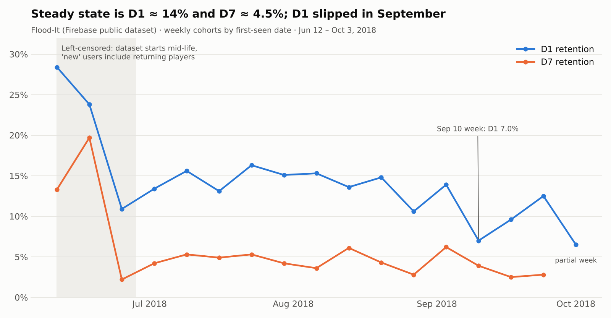

# Flood-It retention analysis

I wanted to practice cohort analysis on real app data, so I used Google's public Firebase export for Flood-It, a small puzzle game. The goal was simple: measure how many new players come back on day 1 and day 7, and figure out what changed when retention dropped in September 2018.

## Data

- `firebase-public-project.analytics_153293282.events_*` in BigQuery (free sandbox)
- Jun 12 – Oct 3, 2018, event-level, obfuscated
- A user's cohort is the first day they show up in the export

## What I found

In July and August, weekly cohorts averaged about 14% D1 and 4.5% D7. That's the baseline I'd trust.

June looked much better (D1 24–28%), and my first instinct was that the game did well at launch. It didn't. The export starts in the middle of the game's life, so the first "new" users include people who were already playing. I excluded those weeks. I also only counted D7 for cohorts that had seven full days of data, otherwise the last weeks look worse than they are.

In September, new users went up but D1 went down, to 7% in the week of Sep 10. I assumed this was a paid campaign bringing in low-quality users. The data says otherwise:

| Segment | New users per week, Jul–Aug → Sep | D1 | D7 |
|---|---|---|---|
| iOS, direct | 230 → 525 | 11.4% → 10.5% | 4.0% → 4.2% |
| Android, direct | 243 → 177 | 13.1% → 9.6% | 3.5% → 2.1% |
| Android, Google Play organic | 170 → 116 | 19.2% → 9.5% | 6.3% → 6.0% |

There's no paid traffic in the data at all. Two things happened instead. Almost all the growth came from iOS, which retains worse than Android organic, so the average dropped just from the mix. And Android D1 fell for every source, organic included. When a drop shows up regardless of where users came from, I'd look at the app itself before the marketing.

## What I'd check next

- Android release notes around early September
- The first-session funnel on Android (first level started vs. completed) before and after that date
- D30, to see whether the September cohorts recover or stay lower

## Limitations

Traffic source detail in this dataset is thin (mostly `(direct)`), and I take platform and source per user with `ANY_VALUE`, which is close to first touch but not exact. These findings describe what happened. Proving why would need release or campaign data.

## Queries

1. `sql/01_daily_cohort_retention.sql`: first pass, daily cohorts
2. `sql/02_weekly_cohort_retention.sql`: weekly cohorts with the date-range issues handled
3. `sql/03_segment_breakdown.sql`: platform and source split I used to test the campaign idea

Mehmet Akif Kara · [LinkedIn](https://www.linkedin.com/in/mehmet-akif-kara)
